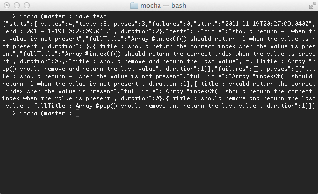

Alias: `JSON`, `json`

The JSON reporter outputs a single large JSON object when the tests have completed (failures or not).

By default, it will output to the console.
To write directly to a file, use `--reporter-option output=filename.json`.

Output uses two-space indentation by default.
Use `--reporter-option indentation=0` for compact, single-line JSON, or another number such as `--reporter-option indentation=4` to change the number of spaces.
The option applies to both console and file output.

When using the JavaScript API, `reporterOption.indentation` also accepts a string, such as `"\t"` for tab indentation.

