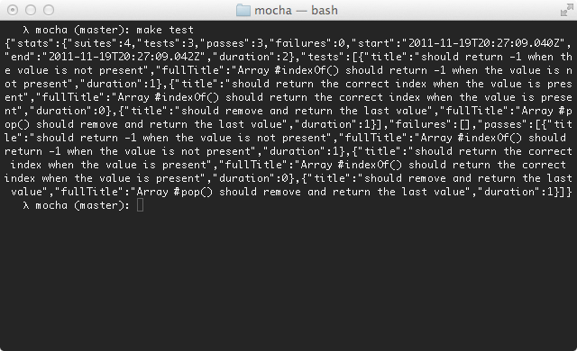

Alias: `JSON`, `json`

The JSON reporter outputs a single large JSON object when the tests have completed (failures or not).

By default, it will output to the console.
To write directly to a file, use `--reporter-option output=filename.json`.

The output is indented with 2 spaces by default.
Use `--reporter-option indent=N` to indent with a different number of spaces, or `--reporter-option indent=0` to output compact JSON on a single line.

